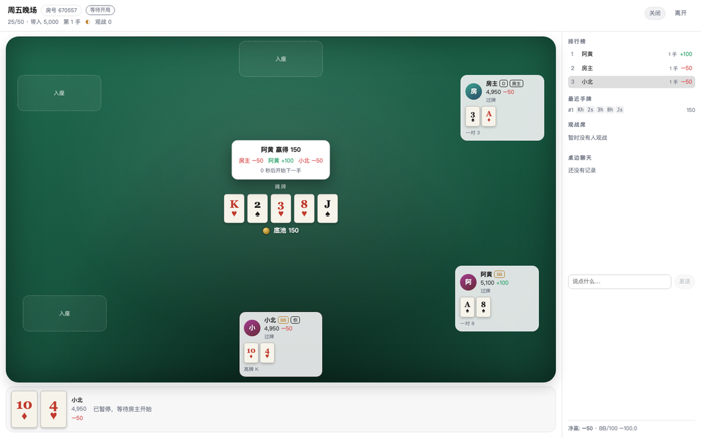
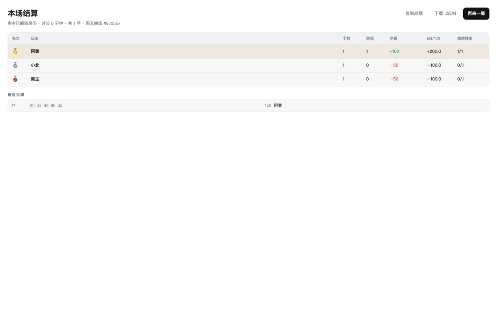

# dsh-holdem-p2p

点对点无限注德州扑克：**房主进程就是服务端**，没有中心服务器。6 人桌，坐满后自动观战，
一手接一手地打，房主决定解散时弹出整场结算与多局排行榜。

- 每手 100BB 带入、筹码重置，累计净赢进入排行榜（现金桌玩法）
- 支持加注/再加注、短筹码全下、多层边池、平局均分、未跟注退回
- 超时自动过牌/弃牌，连续超时进入托管
- 观战者看不到任何未亮出的底牌，有人离座后可以补位
- 断线重连、刷新回到原牌桌；WS 断了自动降级为轮询
- 结算是本机娱乐筹码，**与 DeepSeek 余额无关**

## 安装

本机开发/自用（profile 换成你实际用的那个）：

```sh
dsh plugin --profile desktop add link:/绝对路径/dsh-holdem-p2p
```

或从源码安装：

```sh
pnpm install && pnpm build
dsh plugin --profile desktop add /绝对路径/dsh-holdem-p2p
```

装完刷新页面；「德州扑克」图标会出现在侧栏面板栏里。

## 怎么玩

1. 点侧栏的德州扑克图标，在「创建房间」里填昵称、房间名、盲注，开一桌。
2. 把邀请链接发给朋友（见下一节），或让朋友在本机填 6 位房号加入。
3. 大家点「准备」，房主点「开始」。之后每手结束会自动开下一手。
4. 房主点「解散并结算」，所有人进入本场结算：名次、手数、胜局、净赢、BB/100、摊牌胜率。

房间规则：6 人上限；座位满后新来的人自动观战；观战者可以在等待阶段或有人离座时
补位；一手进行中离开等于弃牌，本手结束后释放座位。

## 界面






- 面板跟随宿主主题：浅色、深色共用一套 token；牌桌绿绒是固定配色。
- 窗口窄于 900px 时牌桌自动切成列表式，结算横幅改回文档流，不会跑出牌桌外。
- 点数与花色按牌面尺寸放大（md 22px / lg 28px），座位小牌 15px。

## 叫人加入

跨机器需要你先把 **publicBaseUrl** 配成外部能访问到这台 `dsh web` 的地址
（例如 Cloudflare Tunnel），否则邀请链接只能在本机打开：

```
Settings → Plugins → dsh-holdem-p2p → publicBaseUrl
```

朋友也需要安装本插件。邀请页会先检查 DSH 与插件是否就绪，再让人点「进入牌桌」。

## 设置

`Settings → Plugins → dsh-holdem-p2p`（由插件 Config 自动生成）：

| 字段 | 说明 | 默认 |
| --- | --- | --- |
| `publicBaseUrl` | 对外地址（纯 origin），空则只能本机加入 | 空 |
| `defaultBlindLevel` | 新房间的默认盲注档位 | `25/50` |
| `turnTimeoutSec` | 每个行动的时限（15–90 秒） | 30 |
| `autoAdvanceSec` | 一手结束后自动开下一手（2–30 秒） | 6 |
| `allowSpectators` | 是否允许观战 | 开 |
| `chatEnabled` | 是否允许桌边聊天 | 开 |
| `maxRooms` | 同时存在的房间上限 | 8 |
| `hostIdleDissolveMin` | 房主失联多久后自动解散（分钟） | 10 |
| `routePrefix` | HTTP 前缀 | `/holdem-p2p` |

改完配置后重启 `dsh`（或等插件重新加载）才会作用于新房间。

## 规则细节

- 盲注档位 `10/20`、`25/50`、`100/200`，带入固定 100BB，每手重置。
- 单挑时按钮位下小盲、翻前先行动，翻后大盲先行动。
- 最小加注为「上一次满额加注量」；短筹码全下**不会**重新开放加注。
- 边池按投入分层，弃牌者的钱留在池里但没有资格；未被跟注的部分原路退回。
- 奇数筹码从按钮左手第一个赢家开始逐个分配。
- 全员全下时按 1.2 秒间隔逐街发完公共牌再摊牌。

## 开发

```sh
pnpm install
pnpm typecheck
pnpm test
pnpm build
pnpm verify        # typecheck + build + test
```

目录：

```
src/index.ts        Host apply：webServer 路由 + WS + 系统提示
src/config.ts       Config（schemastery）与默认值
src/engine/         纯规则：牌、牌型、下注、边池、单手状态机
src/room/           房间状态机、代号/邀请、会话
src/net/            HTTP 路由、WS、Origin/CSRF、邀请页
src/persist/        手牌与会话的 JSONL 审计日志
src/client/         React 面板（factory-CJS 产物）
tests/              引擎、房间、路由、客户端渲染测试
```

- 规则只写在 `src/engine`，权威状态在 Host；客户端不裁定任何结果。
- 换手牌后 `src/client` 需要 `pnpm build` 再刷新页面；改 Host 需要重挂插件或重启 `dsh`。

## 已知限制

- 房主进程天然可信（能改自己的代码），本插件不承诺防作弊。
- 不持久化在线会话：`dsh` 进程重启后房间消失，前端会回到大厅。
- 筹码是娱乐分，没有真实价值，也没有跨房间钱包。
- 观战人数上限 16；房间上限见设置。

## 许可证

MIT。规则引擎与联机骨架分别参考了
[BubblePtr/dsh-holdem](https://github.com/BubblePtr/dsh-holdem) 和
[lifefloating/dsh-doudizhu](https://github.com/lifefloating/dsh-doudizhu)（均为 MIT），
详见 `LICENSE`。
