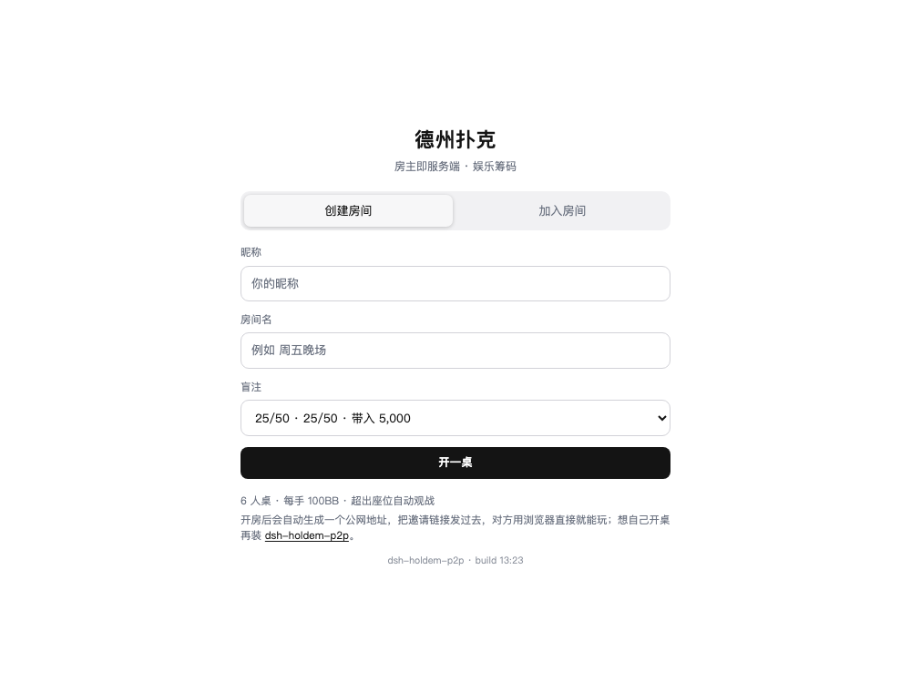
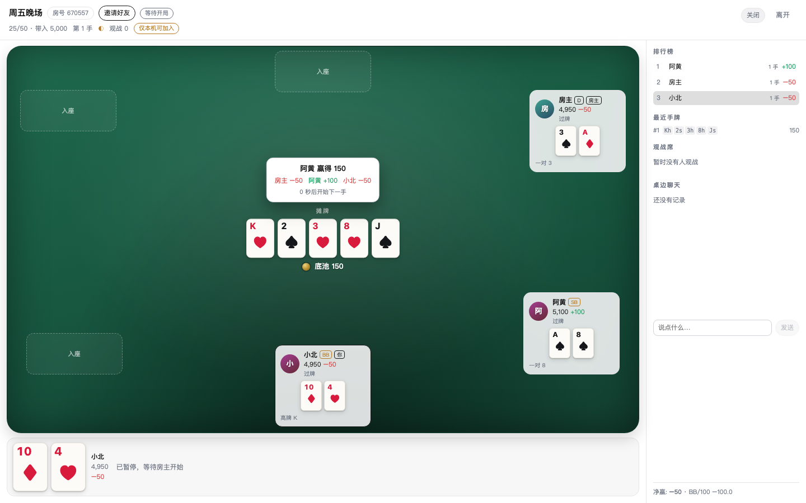
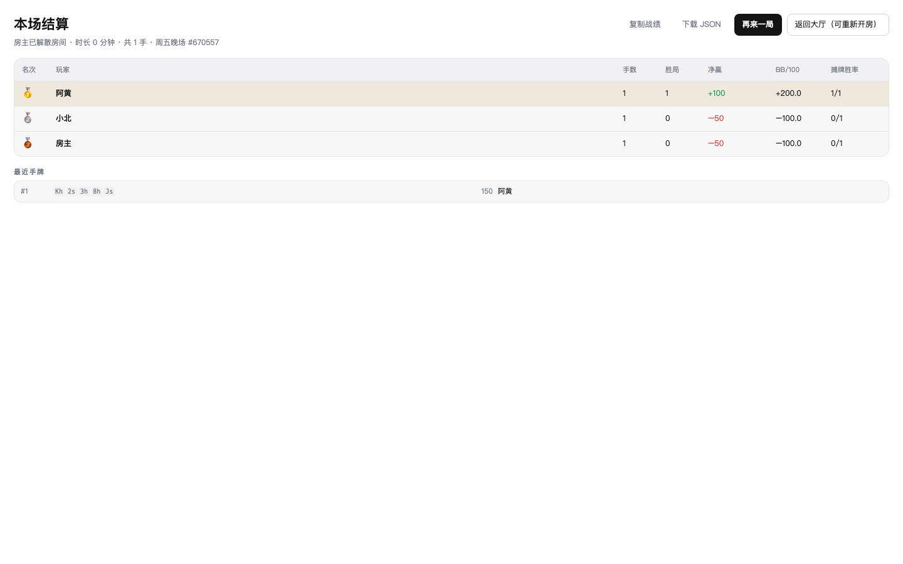

# 德州扑克 · dsh-holdem

DeepSeek Harness 的德州扑克面板插件：6 人无限注德州，超员自动观战，多局累计排行榜。

牌桌有两种跑法，建房时选一个：

| 开桌位置 | 说明 |
| --- | --- |
| **公网 · Cloudflare**（默认） | 牌桌跑在 Cloudflare Worker + Durable Object 上，**关掉你的电脑也能玩**。点一次「授权 Cloudflare」→ 自动部署，地址自动拿到 |
| **本机** | 牌桌跑在你自己的 dsh 进程里，同一 Wi-Fi 的朋友用局域网链接加入 |

加入牌桌**只认邀请链接**：链接里带着房号、邀请凭证和这桌在哪里（本机 / 局域网 / Cloudflare），
把链接发给朋友，用浏览器打开就能玩——对方不需要安装这个插件。

## 安装

### Desktop 版

在 DSH 桌面端的插件安装入口里**直接填写插件名称** `@zhuweiyou/dsh-holdem` 即可。

### Web 版

```sh
dsh plugin --profile web add @zhuweiyou/dsh-holdem
```

包内已包含编译产物（`lib/`），装完即用，不需要再构建。升级同样是再执行一次 `add`。

两版装完都刷新页面，「德州扑克」图标会出现在侧栏面板栏里。

## 界面







## 怎么玩

1. 点侧栏的德州扑克图标 → 选「开桌位置」→ 填昵称、房间名、盲注 → 开一桌。
2. 弹出来的邀请面板里复制链接，发给朋友。
3. 大家「准备」，房主点「开始」；每手结束会自动开下一手。
4. 房主点「解散并结算」（或离开）后，所有人看到本场结算：名次、手数、胜局、净赢、BB/100、摊牌胜率。

房间规则：

- 6 人上限，坐满后新来的人自动观战；观战者可以在等待阶段补位。
- 一手进行中离开等于弃牌，**这手牌会照常打完**，只是不再开新局。
- 每个行动 30 秒（可调 15–90 秒），超时自动过牌/弃牌；连续三次超时进入托管。
- 有人掉线不影响其他人：轮到他会照常走计时，回来还能接上原来的座位和牌。
- 房主离开或失联（默认 10 分钟）会结算整场。

## 设置

`Settings → Plugins → 德州扑克`：

| 字段 | 说明 | 默认 |
| --- | --- | --- |
| `defaultBlindLevel` | 新房间的默认盲注档位 | `25/50` |
| `turnTimeoutSec` | 每个行动的时限（15–90 秒） | 30 |
| `autoAdvanceSec` | 一手结束后自动开下一手（2–30 秒） | 6 |
| `allowSpectators` | 是否允许观战 | 开 |
| `maxSpectators` | 每桌观战席位上限（0–64，`0` 等于不接观战） | 16 |
| `chatEnabled` | 是否允许桌边聊天 | 开 |
| `maxRooms` | 同时存在的房间上限 | 8 |
| `hostIdleDissolveMin` | 房主失联多久后自动结算（分钟） | 10 |
| `routePrefix` | HTTP 前缀 | `/holdem` |

## 规则细节

- 盲注档位 `10/20`、`25/50`、`100/200`，带入固定 100BB，每手重置。
- 单挑时按钮位下小盲、翻前先行动，翻后大盲先行动。
- 最小加注为「上一次满额加注量」；短筹码全下**不会**重新开放加注。
- 边池按投入分层，弃牌者的钱留在池里但没有资格；未被跟注的部分原路退回。
- 奇数筹码从按钮左手第一个赢家开始逐个分配。
- 全员全下时按 1.2 秒间隔逐街发完公共牌再摊牌。

## 已知限制

- 房主进程天然可信（能改自己的代码），不承诺防作弊。
- 牌桌状态在内存里：重启 dsh（本机模式）或 Durable Object 被回收（Cloudflare 模式）后房间消失。
- 筹码是娱乐分，没有真实价值，也没有跨房间钱包。
- 观战席位默认 16，可用 `maxSpectators` 调整；房间上限见设置。
